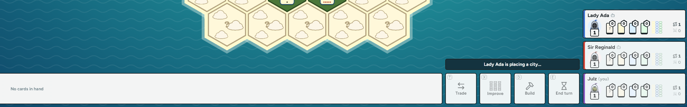
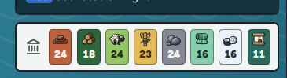

1. homepage always seems to render fresh when navigating around. issue is, that the sign in button is always shortly visible and the threejs animation in the background slowly loads in. can we improve this behavior.
2. can we add a custome loading spinner for initial startup and longer loading sequences? could also add that to button spinner. maybe hex related?
3. classic mode: make points if you own victory points cards like this: e.g. 2 vp cards: 6 (8). So you see what over players also see + additionally the extra points in brackets
4. add a sound effect for longest road (if not there yet, something epic :D)
5. never put the same numbers next to each other -> this has to be generally implemented across all gamemodes and maps. the same numbers shall never be next to each other.
6. We did alot of balancing on veiled isle and similar balancing must be done on e.g. forest map. balanced amount of tile types and numbers.
7. better icons for longest road and knight level. they are very small and can be overlooked. we can use more horizontal space if necessary.
8. always confirm metropolis on a city. players missing the satisfying interaction, even if they have just one city + sound if not yet implemented
9. hover effects wrong on coloured buttons (e.g. choosing progress card when barbarians attack, there are light green, grey and green buttons which all have light blueish hover effect.)
10. remove live stats, players find it a bit cheaty. only keep dice sections with the graphs
11. on wider screens, open up the build menu and add the roads, settlements etc back into the quick buy/edit row. see screenshot, alot of place left 
12. when choosing from a treasure, players complained that they cant see their inventory due to being to blurrey. players should always see their inventory when choosing cards from treasure or aqueduct.
13. a cool feature could be to see the other players mouse indicator. would that be possible? and it also should be toggleble client side to en/disable this feature
14. isled veils: when reveiling a desert tile it should act like a water tile and give the player a random treasure
15. embargo should be pointed out in the log when activating/deactivating
16. emojies should be bigger. how about we span them across the player card and temporarly hiding everything leaving a blank canvas and displaying the emoji on that clean canvas then in a bigger scale. then fade back to player card
17. add the scicor emote
18. timer should only grant +10s in the last 10s, not all the time
19. dices should scale up/down when turn. we had this feature but it got lost along the way
20.  colonist handles it like this: per 5or 6 cards on card and then stack, so people never know exatctly how many cards are left.
21. feature: an in-theme custom cursor. give me 3 options again like we did with the loading spinner
22. knight build menu: should expand into build, improve, displace or chase as individual buttons
