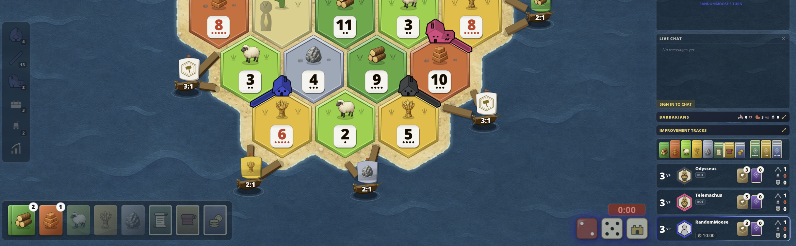
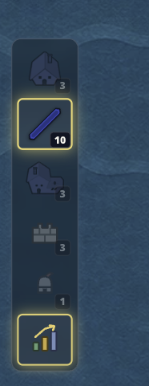
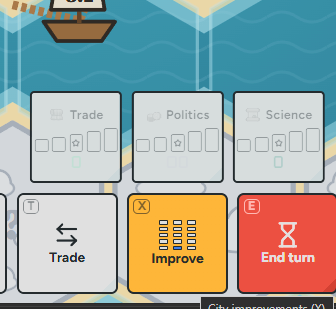
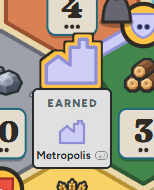

1. homepage always seems to render fresh when navigating around. issue is, that the sign in button is always shortly visible and the threejs animation in the background slowly loads in. can we improve this behavior.
2. can we add a custome loading spinner for initial startup and longer loading sequences? could also add that to button spinner. maybe hex related?
3. classic mode: make points if you own victory points cards like this: e.g. 2 vp cards: 6 (8). So you see what over players also see + additionally the extra points in brackets
4. add a sound effect for longest road (if not there yet, something epic :D)
5. never put the same numbers next to each other -> this has to be generally implemented across all gamemodes and maps. the same numbers shall never be next to each other.
6. We did alot of balancing on veiled isle and similar balancing must be done on e.g. forest map. balanced amount of tile types and numbers.
7. better icons for longest road and knight level. they are very small and can be overlooked. we can use more horizontal space if necessary.
8. always confirm metropolis on a city. players missing the satisfying interaction, even if they have just one city + sound if not yet implemented
9. hover effects wrong on coloured buttons (e.g. choosing progress card when barbarians attack, there are light green, grey and green buttons which all have light blueish hover effect.)
10. remove live stats, players find it a bit cheaty. only keep dice sections with the graphs
11. on wider screens, open up the build menu and add the roads, settlements etc back into the quick buy/edit row. see screenshot, alot of place left 
12. when choosing from a treasure, players complained that they cant see their inventory due to being to blurrey. players should always see their inventory when choosing cards from treasure or aqueduct.
13. a cool feature could be to see the other players mouse indicator. would that be possible? and it also should be toggleble client side to en/disable this feature
14. isled veils: when reveiling a desert tile it should act like a water tile and give the player a random treasure
15. embargo should be pointed out in the log when activating/deactivating
16. emojies should be bigger. how about we span them across the player card and temporarly hiding everything leaving a blank canvas and displaying the emoji on that clean canvas then in a bigger scale. then fade back to player card
17. add the scicor emote
18. timer should only grant +10s in the last 10s, not all the time
19. dices should scale up/down when turn. we had this feature but it got lost along the way
20.  colonist handles it like this: per 5or 6 cards on card and then stack, so people never know exatctly how many cards are left.
21. feature: an in-theme custom cursor. give me 3 options again like we did with the loading spinner

22. treasure chest should also have a variant to drop 2 cards of choice. rebalance accordingly. desert and ocean tiles should also get a card from the pool, so the pool should get 4 more cards and the new variant
23. knights should be able to chase away the pirate ship (k&b x voyager issue)
24. log is not always scrolling correctly along
25. add new colours: #9adbb3, #D3D3FF
26. a second ui variant. the current one should be toggleable to legacy, and the new one experimental. the legacy should stay default for now. have a look at these screenshots from hexed.gg:
    -  i dont like the greyed out cards not that much, so we can keep the current card tray, with cards and progress cards next to each other. but i like the build menu being vertical above the cards. a trade button should also stay next to the cards. trade menu can hide build options. the build options should stay in theme and should not be transparent. i like them being smaller tho.
    -  expand the log to grow. on both themes
    -  highlight available build options

27. knight interaction menu: individual button in the bottom dock. expands into knight actions: activate, displace, chase. Same for ship: displace
28. feature request: eplay feature with timeline etc
29. feature request: A rating system like chess. Rating 1-100, counting blunders etc. do research on chess game evaluation
30. check if we have the same balanced dice as hexed.gg: https://www.hexed.gg/fair-dice
31. cursor feature should be like this: when player 1 turns it on, player 2&3 can already see it. if they dont want to see other cursor, they need to disable it in the settings. also add some clickeffect if thats possible.
32. Lets try to improve the card designs. You have complete freedom to create high quality cards and give me a full set for 3 variants in an artifact. Each progress/development card should get a nice distinguishable design
33.  improve section is still cluttered. can we improve this?
34.  this second click for metropolis isnt needed. just click the spot you want.
35. knights on ship roads should also be able to be displaced. they should funtion similar to when on roads
36. on some prompts where the player can choose cards, they see how many are left by the bank. that shouldnt be possible. only when 0 cards are left, the option should be greyed out. also the menu seems a bit out of date. can you rethink the choose resource menu? the buttons are a bit flimsy
37. 404 page is not in theme (e.g. wrong button)

### Backlog

1. custom icon set for all icons used across the app
2. rethink low poly assets.
   - Settlement, Road, City, Ship, Barbarian, Pirate, Robber, Merchant, Knight
3. custom icon set
