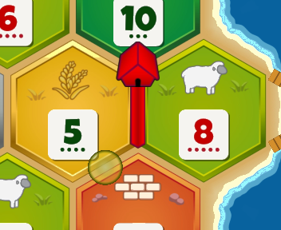
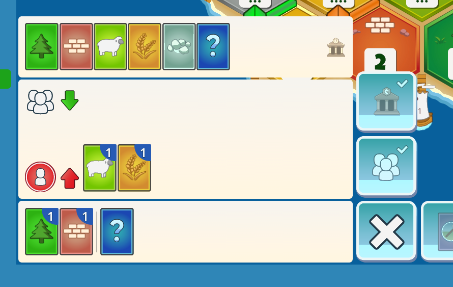
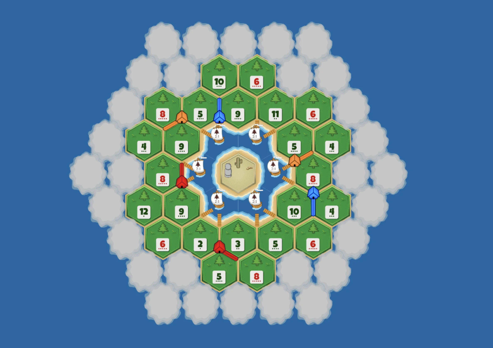
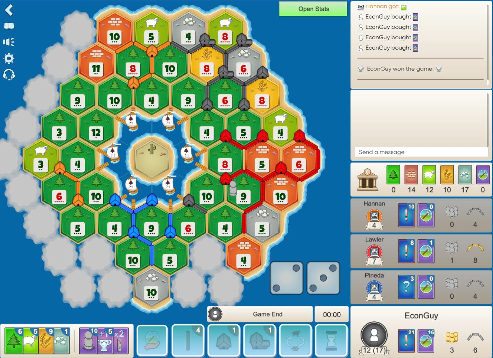
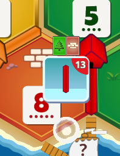

First session feedback:

1. Board looks already nice, but here are some points for each tile-type (3d)
   1. stone: mountains go out of bounds, the mountains dont have to be that high and big, rather more smaller
   2. wheat: doesnt look like wheat fieldss, just random spikes, could have more of a field vibe
   3. sheap: looks cute
   4. wood: looks nice, could be dencer
   5. brick: also goes out of bounds, but still cute
   6. dessert: great
   7. i attached some references for each type that you could implement. keep in m,ind to leave a gap for the number pad. -> E:\Coding\colonist\docs\feedback\round1\maxresdefault.jpg
2. the knight customization was wrongly interpretated. i dont need all thos options, rather a basic figure, where users can upload images to give it a face. if not, it stays the basic knight
3. i attached some images of colonist.io's ui as reference and inspiration. take what you need.
4. the settlements are here and there not visible enough. e.g orange next to brick. they need to be clearly visible.

Round 2:

1. there is a constant effect underneath the 3d board which is very iterating. please remove
2. on colonist.io, players see each card they own better. also they have direct view on there progress cardes. can we improve that part of the ui? als there visualization of of players metropolis progress is way better. -> E:\Coding\colonist\docs\feedback\round1\image.png
3. the number fields on 3d board are sometimes too thin, due too rendering. it may need to be bolder
4. the roll and dice can be split from the bottom ui. i also would prefer it on the right. end turn could be red.
5. chat and log should also be in the top right. colonist.io has a nice layout that we could take as inspo

Round 3:

6. 2D Board needs zoom & pan
7. city walls need to be clearer visible
8. QOL: click on cards to open quick trade menu (like in colonist.io)
9. QOL: Preview opportunities on the map. e.g. if resources for road, add a circle for quick interaction. (like on colonist.io) 
10. Add Map Selection.
11. Default Random Map
12. Bigger Random Map for more players
13. Black Forrest from colonist (Custom Mode from Colonist.io) ; quirks: all forrest at the start, hidden fog of war tiles. optional mode (toggle) with total of 2 gold tiles. gold tiles grants the player to choose the resources they want. its always a 6 or 8. partially revealed: 
14. is this already planned: a stats screen at the end with dice distribution, total cards and more?
15. 3D view needs stronger indication of stronger knights. maybe add a second (and 3rd with the commodity upgrade)? ther knights and on 2d the mark can also be bigger. also the settlements, cities and roasd can be bigger on 2d

Round 4:

1. placing quickly on the board should have a confirmation. so no accidental clicks can cause a build of a roasd or similar.
2. still no paning. maybe with ctrl + click? oder middle mouse?ideally middle mouse
3. sometimes water between tiles. the board should be elevated enough.
4. still no confirmation prompt when placing a road or such. that was asked: 
5. the hints should also only apprear on hover. also should be available for knights and city walls. awlays ask for confirmation.
6. home screen to much ai codedwordings. keep it simple, not much yapping.
7. instead of your stats, make a small pill with user icon and name
8. user should be able to customize the size of the elements. in settings add a setting for it
9. the knight face should be adjustable to place it correctly.
10. in map selection, show a preview of the map along the name
